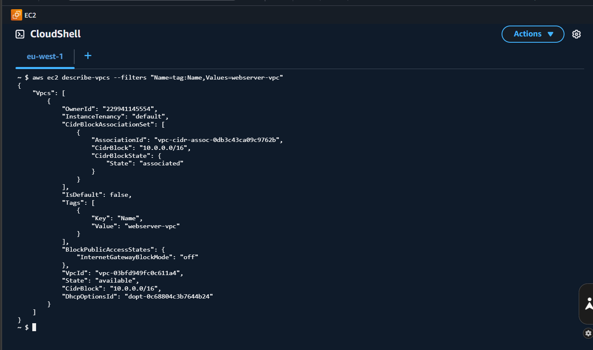
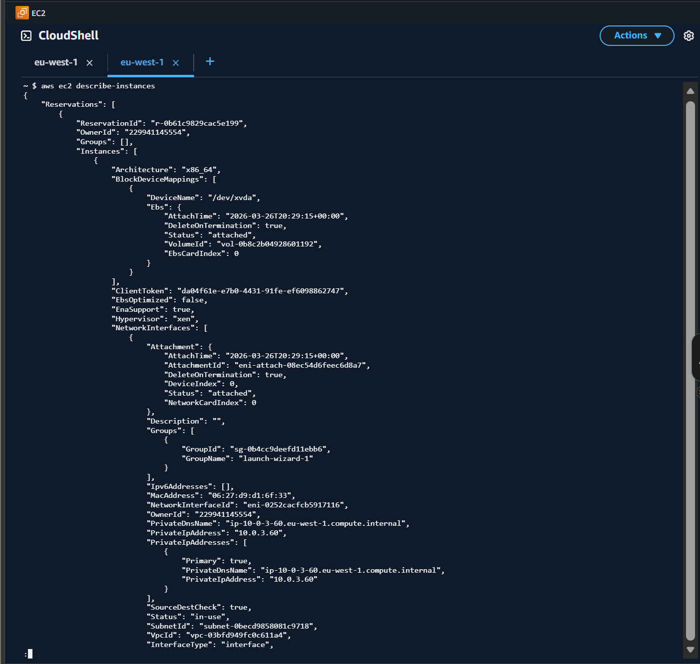
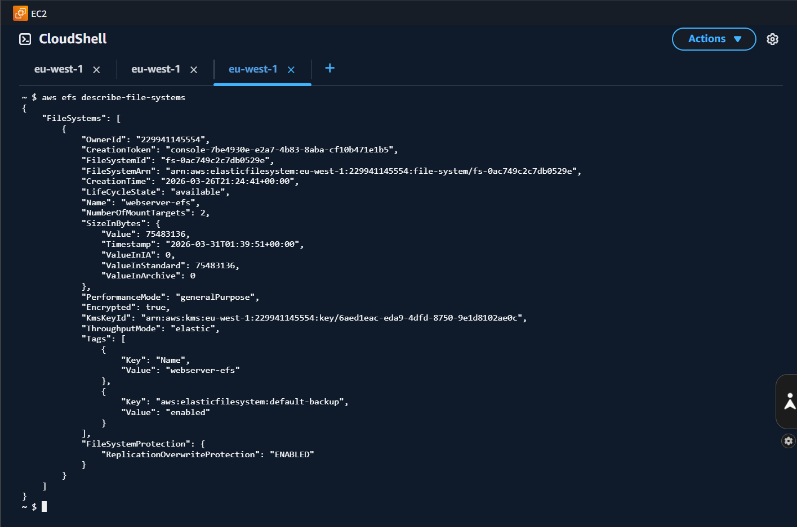
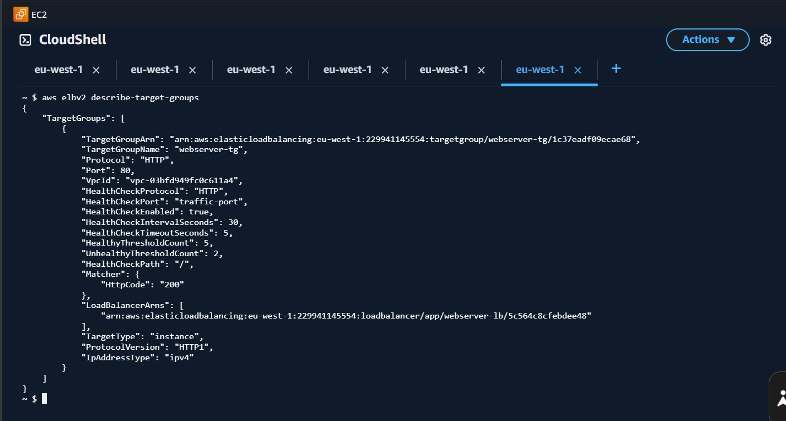
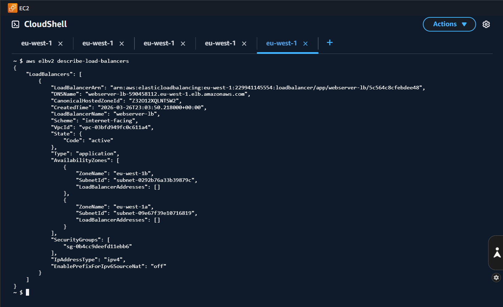

# AWS EFS Load Balancer Website

Cloud Computing project completed at Atlantic Technological University (ATU).

## Project Overview

This project involved building a scalable website using multiple AWS services. The website was hosted on EC2 instances, stored on Amazon EFS, accessed through an Application Load Balancer, and supported file uploads to Amazon S3.

## AWS Services Used

* Amazon VPC
* Amazon EC2
* Amazon EFS
* Amazon S3
* Application Load Balancer
* Auto Scaling Group
* Amazon IAM
* Amazon Machine Image (AMI)

## Architecture Flow

```text
Internet Users
      |
      v
Application Load Balancer
      |
      v
Auto Scaling Group
      |
      v
EC2 Web Servers (Apache + PHP)
      |
      +----> Amazon EFS (Shared Website Files)
      |
      +----> Amazon S3 (File Uploads)

Infrastructure: Amazon VPC, Subnets, Security Groups, IAM
```

## Features Implemented

### Virtual Private Cloud (VPC)

* Custom VPC named webserver-vpc
* CIDR block 10.0.0.0/16
* Public subnets across Availability Zones
* Internet Gateway
* Route Tables

### EC2 Web Servers

* Amazon Linux instances
* Apache Web Server
* PHP support
* SSH access

### Elastic File System (EFS)

* Shared website storage
* Mounted across EC2 instances
* Consistent website content across servers

### Application Load Balancer

* Distributed incoming traffic
* Improved availability and fault tolerance

### Auto Scaling

* Automatic instance deployment
* Launch Templates
* Scalable web infrastructure

### Website Development

* PHP
* HTML
* CSS
* JavaScript

Features included:

* Displaying EC2 instance information
* Displaying hostname and server IP
* Dynamic website content

### Amazon S3 Integration

* File upload functionality
* IAM role-based access
* AWS SDK integration

## Troubleshooting

Several real-world issues were resolved during development, including:

* S3 permission errors
* Auto Scaling instance configuration issues
* EFS mounting issues
* Apache loading index.html instead of index.php

## Learning Outcomes

This project demonstrates practical experience with:

* Cloud Infrastructure
* Web Hosting
* Shared Storage
* Load Balancing
* Auto Scaling
* IAM Permissions
* Linux Administration
* PHP Development
* AWS Architecture Design

## Author

Lina Venckus (Venckuviene)

Computer Science Graduate

Atlantic Technological University (ATU)

## Project Screenshots

The following screenshots demonstrate the AWS infrastructure configured for this project.

### 1. VPC Configuration


### 2. EC2 Instances


### 3. Amazon EFS


### 4. Target Group


### 5. Application Load Balancer

